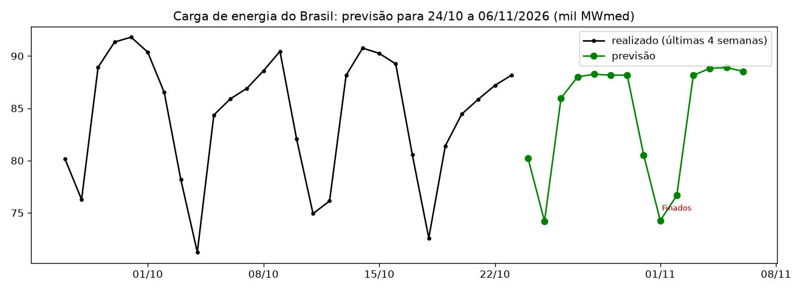
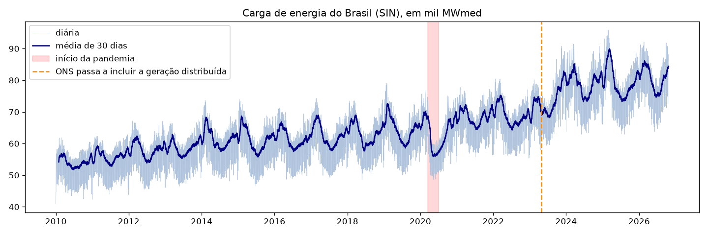
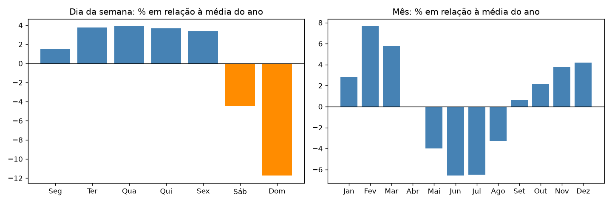
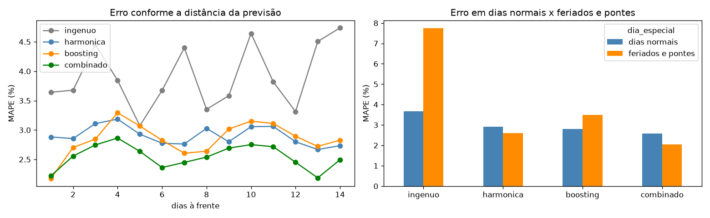
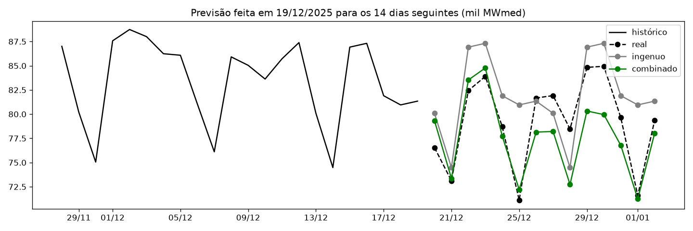

# Previsão da carga de energia do Brasil para os próximos 14 dias

> **Quanta energia o Brasil vai consumir em cada um dos próximos 14 dias?** O operador do sistema elétrico usa essa previsão para decidir quais usinas ligar: errar para menos arrisca falta de energia, errar para mais desperdiça dinheiro. Este projeto prevê a carga diária do Sistema Interligado Nacional (SIN) com dados abertos do ONS e compara modelos estatísticos e de machine learning numa validação que simula um ano de uso real.



## Resumo

- **Dados reais e atualizados:** carga diária das 4 regiões do sistema elétrico de 2010 até hoje, baixada direto do portal de dados abertos do ONS.
- **Modelo final (combinação de regressão harmônica com gradient boosting): erro médio de 2,55%**, contra 3,91% do modelo ingênuo ("repetir a semana passada"), ou seja, **35% menos erro**.
- **Feriados:** nos feriados e "pontes", o modelo ingênuo erra 7,7%; o modelo final erra **2,0%**, graças a um calendário de feriados brasileiros construído no projeto.
- **Validação honesta:** 52 previsões simuladas ao longo de um ano, cada uma treinada só com os dados conhecidos até aquele dia.
- **Pronto para usar:** `python prever.py` baixa os dados mais recentes do ONS e gera a previsão dos próximos 14 dias em CSV e gráfico.

---

## 1. Dados

[Carga de Energia Diária](https://dados.ons.org.br/dataset/carga-energia) do ONS (Operador Nacional do Sistema Elétrico), licença CC-BY: carga média de cada dia, em MWmed, para os subsistemas Sudeste/Centro-Oeste, Sul, Nordeste e Norte. A carga do Brasil (SIN) é a soma dos quatro.

**Problemas de qualidade encontrados e tratados:**

| Problema | Tratamento |
|---|---|
| Datas em dois formatos (em 2013, `2013-01-01 00:00:00`; nos demais anos, `2013-01-01`) | Leitura só da parte da data |
| 13 valores vazios e 1 linha duplicada (Sul, 02/02/2013) | Remoção |
| 3 dias sem nenhum dado (01/12/2013, 01/02/2014 e 09/04/2015) | Interpolação entre o dia anterior e o seguinte |
| **Mudança na forma de medir:** a partir de 29/04/2023 o ONS passou a incluir a geração dos painéis solares nos telhados (micro e minigeração distribuída) | Modelos treinados só a partir dessa data, para não misturar duas definições de carga |

## 2. O que os dados mostram



- **Crescimento:** a carga média passou de ~54 mil MWmed em 2010 para ~81 mil em 2026. Parte dos saltos de +7,1% em 2023 e 2024 vem da mudança na medição, e não só de mais consumo.
- **Pandemia:** em abril de 2020 a carga ficou 12,7% abaixo de abril de 2019, e em maio, 11% abaixo; a recuperação veio a partir de junho.



- **Semana:** de terça a sexta a carga fica ~4% acima da média; aos **domingos, ~12% abaixo** (indústria e comércio parados).
- **Ano:** **fevereiro e março** são os meses de maior consumo (calor e ar-condicionado); **junho e julho**, os de menor (~6,5% abaixo da média).
- **Feriados** (carga do dia x mesmo dia da semana nas semanas vizinhas): 1º de janeiro **-21%**, Natal -19%, Sexta-feira Santa -15%, Dia do Trabalho -11%, Tiradentes, Corpus Christi e Independência cerca de -9%.

## 3. Modelos

| Modelo | Como prevê |
|---|---|
| **Ingênuo** | Repete a última semana. É a referência mínima que qualquer modelo precisa vencer. |
| **Regressão harmônica** | Regressão linear (Ridge) sobre o logaritmo da carga, com tendência, dia da semana, ciclo anual (senos e cossenos) e feriados. Simples e interpretável. |
| **Gradient boosting** | Parte do nível da última semana e aprende, com o calendário, quanto cada dia futuro se afasta dele (dia da semana, época do ano, feriado, ponte, dias à frente). |
| **Combinado** | Média da harmônica com o boosting. |

O calendário de feriados (`src/feriados.py`) é calculado no próprio projeto, sem bibliotecas externas: os feriados móveis (Carnaval, Sexta-feira Santa, Corpus Christi) vêm da data da Páscoa, e são marcadas também as vésperas de Natal e Ano Novo, a Quarta-feira de Cinzas e as "pontes" (segunda antes de feriado na terça, sexta depois de feriado na quinta). O Dia da Consciência Negra entra como feriado nacional a partir de 2024.

## 4. Validação e resultados

**Validação como na vida real (backtesting):** 52 datas, uma por semana ao longo dos últimos 12 meses. Em cada uma, os modelos são treinados só com o que era conhecido até aquele dia e preveem os 14 dias seguintes, totalizando 728 dias previstos. A métrica é o **MAPE**, o erro percentual médio.

| Modelo | MAPE geral | Dias normais | Feriados e pontes |
|---|---|---|---|
| Ingênuo | 3,91% | 3,67% | 7,74% |
| Regressão harmônica | 2,90% | 2,92% | 2,60% |
| Gradient boosting | 2,85% | 2,81% | 3,50% |
| **Combinado** | **2,55%** | **2,58%** | **2,03%** |

Com a carga média atual de ~80 mil MWmed, um erro de 2,55% equivale a cerca de 2 mil MWmed por dia.



**Exemplo: previsão feita em 19/12/2025**, com Natal e Ano Novo no horizonte. O modelo combinado acompanha as quedas dos feriados, enquanto o ingênuo repete a semana anterior. Ele subestima a semana entre o Natal e o Ano Novo, um efeito de fatores que não estão nos dados, como o calor daqueles dias.



## 5. Limitações e próximos passos

- **Temperatura:** é o principal fator que falta. Incluir a previsão do tempo (dados do INMET, por exemplo) deve reduzir bastante o erro, principalmente nas ondas de calor.
- **Prever por região** (Sudeste, Sul, Nordeste, Norte), já que cada uma tem clima e perfil de consumo diferentes.
- **Intervalos de previsão** (faixa provável de valores), além do valor central.
- Agendar o `prever.py` para rodar todo dia e acompanhar o erro real ao longo do tempo.

## 6. Como reproduzir

Requisitos: Python 3.11 e acesso à internet (para baixar os dados do ONS).

```bash
python -m venv .venv
.venv\Scripts\activate        # Windows
# source .venv/bin/activate   # Linux/macOS
pip install -r requirements.txt
```

- **Previsão dos próximos 14 dias:** `python prever.py` (gera `reports/previsao_14_dias.csv` e `reports/figures/previsao_14_dias.png`).
- **Análise completa:** rode os notebooks na ordem: `notebooks/01_exploracao.ipynb` (download, tratamento e exploração) e `notebooks/02_modelagem.ipynb` (modelos e validação).

## 7. Estrutura do projeto

```
previsao-carga-energia/
├── notebooks/
│   ├── 01_exploracao.ipynb   # download, qualidade dos dados, sazonalidade e feriados
│   └── 02_modelagem.ipynb    # comparação dos modelos e validação
├── src/
│   ├── dados.py              # download e tratamento dos dados do ONS
│   ├── feriados.py           # calendário de feriados brasileiros (Páscoa, pontes, vésperas)
│   └── modelos.py            # modelos e backtesting
├── reports/
│   ├── previsao_14_dias.csv  # última previsão gerada
│   └── figures/              # gráficos deste README
├── prever.py                 # previsão dos próximos 14 dias com dados atualizados
├── requirements.txt
└── README.md
```

## 8. Tecnologias

Python · pandas · NumPy · scikit-learn (Ridge, HistGradientBoosting) · Matplotlib · Jupyter · séries temporais · backtesting

## Autor

**Igor Bicalho**, cientista de dados
[LinkedIn](https://www.linkedin.com/in/igorcbicalho)

*Dados: ONS (Operador Nacional do Sistema Elétrico), Dados Abertos, licença CC-BY.*
